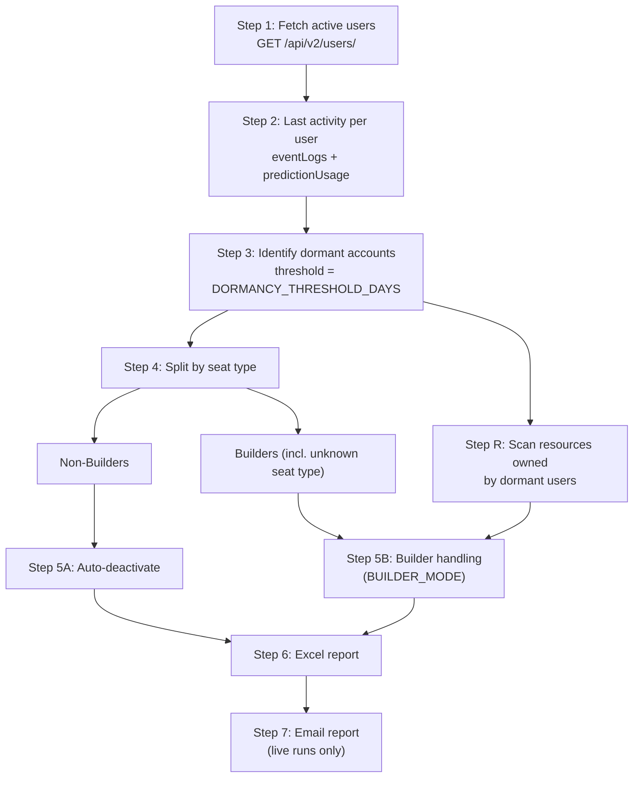

# Dormancy Custom Job — Inactive Users Cleanup

A DataRobot Custom Job that finds dormant DataRobot user accounts, inventories the resources they own, deactivates the ones that are safe to deactivate, produces an Excel report for admins, and optionally emails a summary to the security team.

The pipeline is **safe by default**: `DRY_RUN=true` logs what would happen without changing any account.

---

## Table of contents

- [How it works](#how-it-works)
- [Pipeline steps](#pipeline-steps)
- [Repository layout](#repository-layout)
- [Configuration](#configuration)
- [Running as a DataRobot Custom Job](#running-as-a-datarobot-custom-job)
- [Running locally](#running-locally)
- [Output files](#output-files)
- [Excel report](#excel-report)
- [Email report](#email-report)
- [Safety model](#safety-model)
- [Troubleshooting](#troubleshooting)

---

## How it works



Each step reads the JSON written by the previous step from the `output/` directory and writes its own JSON and CSV there. Because of this, any step can be re-run on its own, and the pipeline can be resumed from any step.

---

## Pipeline steps

`run_all.py` runs the steps in this order: `1 → 2 → 3 → 4 → R → 5 → 6 → 7`.

### Step 1: Fetch active users (`fetch_active_users.py`)

- Pages through `GET /api/v2/users/` (`PAGE_SIZE` per page, default 100).
- Records each user's `user_id`, `email`, `seat_type`, and `is_active`. Field names are normalized across API versions (`userId`/`id`/`uid`, `seatType`/`seat_type`, `isActive`/`activated`/`is_active`).
- Skips users who are already inactive. Inactive users are filtered on the client side because some deployments don't support `isActive` as a query parameter.
- Applies `EXCLUDE_ACCOUNTS` (never processed) and `INCLUDE_ONLY_ACCOUNTS` (process only these).
- **Writes:** `active_users.json`, `active_users.csv`

### Step 2: Determine last activity (`check_last_activity.py`)

For each active user, it checks two sources within the lookback window (the last `DORMANCY_THRESHOLD_DAYS` days):

1. **App usage:** `GET /api/v2/eventLogs/?userId=…&order=desc`. It takes the newest event that is not an admin action. Admin actions are listed in `EXCLUDED_EVENT_TYPES` (default: `Activate account`, `Deactivate Account`, `Update account`), so an admin touching an account doesn't count as the user being active.
2. **Prediction usage:** `GET /api/v2/eventLogs/predictionUsage/`. This endpoint only accepts a 24-hour window, so the script scans backwards one day at a time from now to the cutoff and stops at the first event it finds.

The later of the two timestamps becomes `last_activity`. The source and event type are recorded in `last_activity_type`. If a user has no activity inside the window, `last_activity` is empty.

- **Writes:** `user_activity.json`, `user_activity.csv`

### Step 3: Identify dormant accounts (`identify_dormant_users.py`)

A user is **dormant** if either:

- `last_activity` was `DORMANCY_THRESHOLD_DAYS` or more days ago, or
- there is no recorded activity in the window. These users get `days_dormant = 9999`, which the reports show as "No activity".

Dormant users are sorted with the longest-dormant first.

- **Writes:** `dormant_users.json`, `dormant_users.csv`

### Step 4: Split by seat type (`split_by_seat_type.py`)

Dormant users are split into two lanes:

| Lane | Rule | Next step |
|---|---|---|
| **Non-Builder** | `seat_type` matches a value in `NON_BUILDER_SEAT_TYPES` (case-insensitive; default `Non-Builder,viewer,consumer,read-only`) | 5A: auto-deactivation |
| **Builder** | Any other seat type, **including missing or unknown** | 5B: Builder handling |

Users without a seat type go into the Builder lane on purpose, so that an uncertain classification ends up with a human reviewer instead of being deactivated automatically.

- **Writes:** `dormant_non_builders.json/.csv`, `dormant_builders.json/.csv`

### Step R: List resources owned by dormant users (`list_user_resources.py`)

This step scans the whole instance and matches each resource's owner against the dormant users:

| Resource type | Endpoint | How ownership is detected |
|---|---|---|
| Deployments | `/api/v2/deployments/` | `creator.id`, `owners.preview[].id` |
| Projects | `/api/v2/projects/{id}/accessControl/` | entries with `role == OWNER` |
| Custom models | `/api/v2/customModels/` | `createdBy` (ID or email) |
| Custom applications | `/api/v2/customApplications/` | `userId` |
| Custom jobs | `/api/v2/customJobs/` | `userId` or `createdBy.id` |
| Use cases | `/api/v2/useCases/` | `owners[].id` |
| Registered models | `/api/v2/registeredModels/` | `createdBy` (ID or email) |
| Batch predictions | `/api/v2/batchPredictions/` | `userId` |
| Notebooks | `/api/v2/notebooks/` | `userId` / `ownerId` / `createdBy.id` (best effort) |

Projects need one access-control call per project, so this is usually the slowest step on large instances.

- **Writes:** `dormant_user_resources.json` (one entry per user, with counts), `dormant_user_resources.csv` (one row per resource)

### Step 5: Deactivate dormant users (`deactivate_users.py`)

Deactivation sends `PATCH /api/v2/users/{id}/` with `{"activated": false}`. If the server returns HTTP 422, it retries with `{"isActive": false}` for older API versions. When `DRY_RUN=true`, no PATCH calls are made.

**5A: Non-Builders.** Every Non-Builder dormant user is deactivated.

**5B: Builders.** The behavior is set by `BUILDER_MODE`:

| `BUILDER_MODE` | Behavior |
|---|---|
| `resource_inventory` *(default)* | Uses the Step R inventory. Builders who own 0 resources are deactivated; those who own resources are flagged for manual review. |
| `manual_review` | No API calls. Every Builder is flagged for manual review. |
| `resource_check` | For each user, queries deployments, running jobs, and custom apps. Builders with none are deactivated. If an endpoint can't be reached, the user is flagged rather than deactivated. May not work on every deployment. |
| `force_deactivate` | Deactivates **every** dormant Builder regardless of what they own. Enabled by `run_all.py --force-deactivate`. |

Each user ends up with one of these statuses:

| Status | Meaning |
|---|---|
| `DEACTIVATED` | Account was deactivated (live run) |
| `DRY_RUN` | Would have been deactivated |
| `FAILED` | The PATCH call failed; the HTTP status and response are recorded |
| `PENDING_MANUAL_REVIEW` | Flagged by `manual_review` mode |
| `MANUAL_REVIEW_HAS_RESOURCES` | The Builder owns resources (or ownership couldn't be confirmed), so the account was not deactivated |

- **Writes:** `deactivation_results.json`, `deactivation_results.csv`

### Step 6: Generate Excel report (`generate_report.py`)

Builds `output/inactive_users_report_<YYYYMMDD>.xlsx` from all earlier outputs. See [Excel report](#excel-report).

### Step 7: Email report (`send_report_email.py`)

Sends an HTML summary of deactivated accounts over SMTP. It **only** sends when `SEND_EMAIL=true` **and** `DRY_RUN=false`; otherwise the step is skipped. See [Email report](#email-report).

---

## Repository layout

| File | Purpose |
|---|---|
| `run.sh` | Custom Job entrypoint script; runs `python custom_job.py` |
| `custom_job.py` | Maps DataRobot-injected environment variables (`DATAROBOT_ENDPOINT` → `DATAROBOT_API_URL`, stripping `/api/v2`), logs the effective settings, then calls `run_all.main()` |
| `run_all.py` | Runs the steps in order; supports `--from`, `--only`, and `--force-deactivate` |
| `metadata.yaml` | Custom Job name, description, and runtime parameter definitions |
| `fetch_active_users.py` | Step 1 |
| `check_last_activity.py` | Step 2 |
| `identify_dormant_users.py` | Step 3 |
| `split_by_seat_type.py` | Step 4 |
| `list_user_resources.py` | Step R |
| `deactivate_users.py` | Step 5 |
| `generate_report.py` | Step 6 |
| `send_report_email.py` | Step 7 |

---

## Configuration

All settings are environment variables. In a Custom Job they come from the runtime parameters in `metadata.yaml`. Locally they can be set in the shell or in a `.env` file, which is loaded automatically if `python-dotenv` is installed.

### Connection

| Variable | Default | Description |
|---|---|---|
| `DATAROBOT_API_URL` | — | Base URL of the DataRobot instance, without `/api/v2`. In a Custom Job this comes from `DATAROBOT_ENDPOINT`. |
| `DATAROBOT_API_TOKEN` | — | API token. Injected automatically in a Custom Job. **Needs admin rights** to list users, read event logs for all users, and deactivate accounts. |

### Exposed as runtime parameters in `metadata.yaml`

| Variable | Default | Description |
|---|---|---|
| `DRY_RUN` | `true` | `true` only logs what would happen. Set to `false` to really deactivate accounts. |
| `DORMANCY_THRESHOLD_DAYS` | `40` | Days without activity before a user counts as dormant. This is also the activity lookback window. |
| `EXCLUDE_ACCOUNTS` | *(empty)* | Comma-separated emails that are never processed (for example, service accounts and break-glass admins). |
| `INCLUDE_ONLY_ACCOUNTS` | *(empty)* | Comma-separated emails. When set, **only** these users are processed. Useful for testing on a small group. |
| `SEND_EMAIL` | `false` | `true` emails the report (live runs only). |
| `SMTP_HOST` | `smtp.office365.com` | SMTP server. |
| `SMTP_PORT` | `587` | `587` for STARTTLS, `25` for internal relays. |
| `SMTP_USE_CRED` | *(empty = auto)* | `true`/`false` forces SMTP authentication on or off. In auto mode, authentication is used only when both `SMTP_USER` and `SMTP_PASSWORD` are set. STARTTLS is used whenever authentication is. |
| `SMTP_USER` | *(empty)* | SMTP login, usually the sender address. |
| `SMTP_PASSWORD` | *(unset)* | A DataRobot **credential**. The password is read from the credential JSON. A plain-text value also works for local runs. |
| `EMAIL_FROM` | `SMTP_USER` | Sender address. |
| `EMAIL_TO` | *(empty)* | Comma-separated recipients. |

### Advanced (environment only)

These are commented out in `metadata.yaml`. Uncomment them there to expose them in the Custom Job UI.

| Variable | Default | Description |
|---|---|---|
| `BUILDER_MODE` | `resource_inventory` | How dormant Builders are handled (see [Step 5](#step-5-deactivate-dormant-users-deactivate_userspy)). |
| `NON_BUILDER_SEAT_TYPES` | `Non-Builder,viewer,consumer,read-only` | Seat types treated as Non-Builder. |
| `EXCLUDED_EVENT_TYPES` | `Activate account,Deactivate Account,Update account` | Event-log events that don't count as user activity. |
| `PAGE_SIZE` | `100` | Page size for list endpoints. |
| `REQUEST_TIMEOUT` | `30` | HTTP timeout in seconds. |
| `MAX_RETRIES` | `3` | Retry attempts for HTTP 5xx errors, connection errors, and timeouts. |
| `RETRY_BACKOFF` | `2.0` | Exponential backoff base, in seconds. |
| `REQUEST_DELAY` | `0.2` (`0.3` in Step 5) | Pause between per-user API calls, to avoid rate limiting. |
| `SSL_VERIFY` | `false` | `true` turns on TLS certificate verification. |

HTTP 429 responses are retried after the server's `Retry-After` delay. HTTP 403/404 responses on read endpoints are treated as "no data" and don't stop the pipeline.

---

## Running as a DataRobot Custom Job

1. In DataRobot, go to **Registry → Jobs** and create a new Custom Job.
2. Upload every file in this repository. The job's entrypoint is `run.sh`.
3. Pick an execution environment that has Python 3.9+ with `requests`, `urllib3`, and `openpyxl` installed (`python-dotenv` is optional).
4. Set the runtime parameters from `metadata.yaml`. For the first run, keep `DRY_RUN=true` and consider setting `INCLUDE_ONLY_ACCOUNTS` to a few test users.
5. If you want email, create a **Basic** credential holding the SMTP password, select it for `SMTP_PASSWORD`, and set `SEND_EMAIL`, `SMTP_USER`, and `EMAIL_TO`.
6. Run the job. Check the logs and the Excel report in the job's artifacts.
7. When the dry-run results look right, set `DRY_RUN=false`. You can also put the job on a schedule (for example, weekly).

`DATAROBOT_ENDPOINT` and `DATAROBOT_API_TOKEN` are injected automatically. The job runs with the permissions of the user who runs it, so that user must be an **admin** who can manage users.

---

## Running locally

```bash
pip install requests urllib3 openpyxl python-dotenv
```

Create a `.env` file (it's in `.gitignore`):

```bash
DATAROBOT_API_URL=https://app.datarobot.com
DATAROBOT_API_TOKEN=<admin-api-token>
DRY_RUN=true
DORMANCY_THRESHOLD_DAYS=40
```

Then run:

```bash
python run_all.py                       # full pipeline, dry run (safe)
DRY_RUN=false python run_all.py         # full pipeline, real deactivation
python run_all.py --from 3              # resume from Step 3 onward
python run_all.py --only 6              # re-run only Step 6 (the report)
python run_all.py --only R              # re-run only the resource scan
python run_all.py --force-deactivate    # BUILDER_MODE=force_deactivate (combine with DRY_RUN=false to apply)
```

Each step can also be run on its own, for example `python identify_dormant_users.py`. Valid step labels for `--from` and `--only` are `1`, `2`, `3`, `4`, `R`, `5`, `6`, and `7`.

If a step fails, the pipeline stops there and exits with a non-zero code.

---

## Output files

Everything is written to `output/`, next to the scripts:

| File | Written by | Contents |
|---|---|---|
| `active_users.json/.csv` | Step 1 | Active users after the exclude/include filters |
| `user_activity.json/.csv` | Step 2 | The above, plus last app usage, last prediction usage, and last activity with its type |
| `dormant_users.json/.csv` | Step 3 | Dormant users with `days_dormant` |
| `dormant_non_builders.json/.csv` | Step 4 | Non-Builder lane |
| `dormant_builders.json/.csv` | Step 4 | Builder lane |
| `dormant_user_resources.json/.csv` | Step R | Resource inventory (per user in JSON, per resource in CSV) |
| `deactivation_results.json/.csv` | Step 5 | Final status for each dormant user |
| `inactive_users_report_<YYYYMMDD>.xlsx` | Step 6 | Admin report |

These files contain user emails and IDs. Don't commit them.

---

## Excel report

| Tab | Contents |
|---|---|
| **Summary** | Run time, instance URL, threshold, mode (DRY RUN or LIVE), Builder mode, dormant counts, results per lane, and resource inventory totals |
| **Non-Builder — Deactivated** | One row per Non-Builder: email, ID, seat type, last activity and its type, days dormant, status, and HTTP detail |
| **Builder — Manual Review** | Builder rows with deployment, job, app, and total resource counts |
| **Resource Inventory** | One row per resource owned by a dormant user: type, name, ID, status, and creation date |
| **Audit Log** | Every action taken, or that would be taken in a dry run, with HTTP status and response detail |

Status cells are color-coded: green for deactivated, blue for dry run, red for failed, yellow for pending review, and orange for owns resources.

---

## Email report

When `SEND_EMAIL=true` and `DRY_RUN=false`, Step 7 sends an HTML email:

- **Subject:** `DataRobot Inactive Users Report — <YYYY-MM-DD> — <N> user(s) deactivated`
- **Body:** the date, dormancy threshold, number deactivated, total processed, and the list of deactivated emails

SMTP modes:

- **Office 365 or other authenticated SMTP:** set `SMTP_USER` and `SMTP_PASSWORD`, and use port 587. The job uses STARTTLS and logs in.
- **Internal open relay:** leave `SMTP_USER` and `SMTP_PASSWORD` empty (or set `SMTP_USE_CRED=false`), and use port 25. Mail is sent without TLS or login.

`SMTP_USER` and `SMTP_PASSWORD` must both be set or both be empty. If the email configuration is incomplete, the step logs the problem and skips sending without failing the pipeline.

---

## Safety model

- **Dry run by default.** Nothing is deactivated unless `DRY_RUN=false` is set explicitly.
- **Unknown means Builder.** A user with a missing or unrecognized seat type goes to the Builder lane, not to auto-deactivation.
- **Resource owners are protected.** In the default `resource_inventory` mode, a Builder who owns any deployment, project, model, app, job, use case, notebook, or batch prediction is flagged for review instead of deactivated.
- **Admin actions don't count as activity.** Activating, deactivating, or updating an account doesn't reset the dormancy clock.
- **Allow and deny lists.** `EXCLUDE_ACCOUNTS` protects specific accounts; `INCLUDE_ONLY_ACCOUNTS` limits a run to a test group.
- **Deactivation, not deletion.** Accounts are only deactivated and can be reactivated by an admin. No resources are deleted or transferred.
- **Audit trail.** Every action is recorded in `deactivation_results.*` and in the report's Audit Log tab.

---

## Troubleshooting

| Symptom | Likely cause and fix |
|---|---|
| `DATAROBOT_API_URL is not set` | Running locally without a `.env` file. Set `DATAROBOT_API_URL` and `DATAROBOT_API_TOKEN`. |
| Many users show "No activity" | The token can't read other users' event logs (HTTP 403 is treated as no data). Use an admin token. |
| `BUILDER_MODE=resource_inventory requires …dormant_user_resources.json` | Step 5 ran without Step R. Run `python run_all.py --from R`. |
| PATCH fails with HTTP 403 | The token's user doesn't have permission to manage users. |
| SSL errors | Certificate verification is off by default. If you've set `SSL_VERIFY=true`, make sure the instance's CA certificate is trusted. |
| Email not sent | Check that `SEND_EMAIL=true`, `DRY_RUN=false`, `EMAIL_TO` is set, and `SMTP_USER`/`SMTP_PASSWORD` are both set or both empty. |
| Resource scan is slow | Projects need one access-control call per project. Raise `PAGE_SIZE`, or lower `REQUEST_DELAY` if rate limits allow. |
